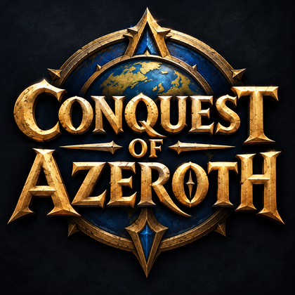

<!-- 主题视觉：征服艾泽拉斯：荣耀徽章.png。仓库内以 .github/assets/coa-emblem.png（420×420）归档。
     图片使用仓库内绝对地址：.github/README.md 中的相对 img 路径不会被 GitHub 重写，主页会破图；
     文件名用纯 ASCII，避免中文与全角冒号在图片 URL 中的编码问题。改分支名或仓库名时需同步此处。 -->

  

<h1 align="center">征服艾泽拉斯 · Conquest of Azeroth</h1>

  <strong>面向 Ascension 3.3.5a 客户端的 AzerothCore 服务端重建工程</strong> 
  协议兼容 · 自定义职业 · 账号级收藏 · 玩法系统重建 · 可验证交付

  客户端 <strong>Ascension 3.3.5a</strong> · 核心 <strong>AzerothCore</strong> · 语言 <strong>C++</strong> · 构建 <strong>CMake</strong> · 许可 <strong>GPL-2.0</strong>

---

## 项目简介

本仓库是 [AzerothCore](https://github.com/azerothcore/azerothcore-wotlk)（World of Warcraft 3.3.5a / WotLK，C++ / CMake / MySQL）的一个 fork。目标不是复刻一套原版怀旧服，而是在 AzerothCore 引擎之上，把 **Ascension 3.3.5a 客户端**所需的协议、数据与玩法，在服务端侧独立重建出来。

CoA（Conquest of Azeroth）因此不是可选插件，而是编译进 worldserver 的**必选服务端组件**（`src/server/coa/`）：它承担客户端协议适配、账号级收藏（幻化衣橱）、角色成长、自定义职业与资源、以及职业机制修正，由 `AddCoAScripts()` 在 worldserver 脚本初始化时注册，与可选模块相互独立。

> **说明**：这是对客户端可观测行为与公开资料的独立重建，不代表与任何官方服务端功能完全对等。客户端二进制、生成的 DBC 候选、运行时数据库与部署凭证均存放在本仓库之外；仓库内不提供、也不打包任何客户端资源。

## 项目特点

**1. 服务端与客户端之间的兼容层**
扩展 opcode 与会话处理（登录、Realm 列表、外观套装、客户端配置、副本绑定、工单、物品能量提示等）、客户端 DBC 行流式下发、登录期 Lua 热补丁，均在 [CoA 组件文档](../docs/coa/README.md) 中逐一列出；登录心跳与自然回生按客户端实际节奏适配。

**2. 数据由客户端 DBC 驱动**
天赋目录在启动时从 `CharacterAdvancement.dbc` 读取，法术与任务的获取路径可由 [coa-mechanics](../apps/coa-mechanics/README.md) 的机制图核对，DBC 的提取与校验由 [coa-dbc](../apps/coa-dbc/README.md) 完成。服务端不臆造外观记录或客户端 DBC 行。

**3. 玩法系统在服务端侧重建**
思路是"客户端已有界面、服务端补齐权威逻辑"：威望模式（Chromie 时光回溯）、挑战 / 试炼（生命数、规则、目标、排行榜与奖励）、Path to Ascension 教程书进程、Ascension 法术书训练师、英雄召唤板日常、War Games 私人竞技场、世界锻造升级、无尽 Manastorm 等，均由服务端提供状态与裁决。

**4. 高度模块化**
`modules/` 下 30 余个内容模块，每个模块自带 `src/` 与配置模板，可用 `-DMODULE_<目录名大写>=disabled` 单独关闭（见[模块编写说明](../modules/how_to_make_a_module.md)）。`modules/mod-ascension/` 仅保存历史 SQL 迁移，不是可构建模块。

**5. 世界数据库以"包"交付**
worldserver 与 `dbimport` 在 `Updates.AutoSetup` 发现空库时，从 [世界数据库包](../apps/coa-world/README.md) 导入并校验 `baseline.json`、归档与逐表校验和，而不是使用 `data/sql/base/db_world/`。已应用的迁移按文件名与哈希追踪，历史 SQL 不可改动。

**6. 单一验证门禁**
所有改动统一通过 `python -B tools/verify_all.py` 验证，覆盖源码检查、构建、单元测试、Python 测试脚本、`apps/coa-tests` harness 与 gameplay 场景，并支持按 `--stages` / `--scenario` / `--harness` 聚焦。详见[验证指南](../docs/coa/verification.md)。

### 代表模块

| 方向 | 模块 | 说明 |
| --- | --- | --- |
| 进阶成长 | [mod-coa-prestige](../modules/mod-coa-prestige/README.md) | 威望模式：满级后回到 1 级重练，逐级领取奖励 |
| 进阶成长 | [mod-path-to-ascension](../modules/mod-path-to-ascension/README.md) | 教程书目录与由服务端事件驱动的进度校验 |
| 挑战副本 | [mod-coa-challenges](../modules/mod-coa-challenges/README.md) | 挑战 / 试炼的激活门槛、光环、生命、规则与奖励 |
| 挑战副本 | [mod-coa-mythic-plus](../modules/mod-coa-mythic-plus/) · [mod-coa-raid-difficulty](../modules/mod-coa-raid-difficulty/) | 大秘境与团队副本难度 |
| 挑战副本 | [mod-war-games](../modules/mod-war-games/README.md) · [mod-manastorm-endless](../modules/mod-manastorm-endless/README.md) | 私人竞技场约战与无尽 Manastorm |
| 装备经济 | [mod-worldforged-upgrades](../modules/mod-worldforged-upgrades/README.md) | 时光守护者的自定义商店与装备升级 |
| 装备经济 | [mod-ethereal-bazaar](../modules/mod-ethereal-bazaar/) · [mod-ah-bot-plus](../modules/mod-ah-bot-plus/README.md) | 幻化市集与拍卖行机器人 |
| 职业技能 | [mod-spellbook](../modules/mod-spellbook/README.md) | 把 Ascension 之书恢复为带等级门槛的职业训练师 |
| 日常便利 | [mod-hero-call-board](../modules/mod-hero-call-board/README.md) | 英雄召唤板 47 项日常与 PvE / 专业 / PvP 三类任务板 |
| 伴侣系统 | [mod-playerbots](../modules/mod-playerbots/README.md) | CoA 分支的机器人玩家 |

> 完整清单见 [`modules/`](../modules/)。第三方模块各自的许可与致谢以其目录内声明为准。

## 快速开始

1. **先读约定**：[AGENTS.md](../AGENTS.md) 与[构建指南](../.agents/docs/build.md)。
2. **编译服务端**：CMake 工程，CoA 组件由 `src/server/coa/CMakeLists.txt` 独立构建并随 worldserver 注册，无需额外启用模块。
3. **准备世界库**：留空即可，worldserver / `dbimport` 会自动导入[世界数据库包](../apps/coa-world/README.md)；手动导入、审计与更新的方式见同一文档。
4. **放置客户端 DBC**：CoA 客户端 DBC 位于 `env/dist/data/dbc`，并在 `worldserver.conf` 中将 `DataDir` 指向 `env/dist/data`（详见 [CoA 组件文档](../docs/coa/README.md)）。
5. **验证**：运行 `python -B tools/verify_all.py`，按需加 `--stages` 与聚焦参数（[验证指南](../docs/coa/verification.md)）。

配置模板安装到 `etc/modules/coa.conf` 与 `etc/modules/coa_bugreport.conf`；运行时配置请勿提交到仓库。环境准备也可参考上游的[安装文档](http://www.azerothcore.org/wiki/installation)。

## 文档导航

| 文档 | 用途 |
| --- | --- |
| [AGENTS.md](../AGENTS.md) | 仓库约定、SQL 边界、验证与任务路由 |
| [.agents/README.md](../.agents/README.md) · [.agents/docs/build.md](../.agents/docs/build.md) | 智能体协作说明 / CMake 构建 |
| [docs/coa/README.md](../docs/coa/README.md) | CoA 组件总览：协议、DBC、数据库、职业机制 |
| [docs/coa/verification.md](../docs/coa/verification.md) | 验证门禁各阶段与参数 |
| [apps/coa-dbc/README.md](../apps/coa-dbc/README.md) | 客户端 DBC 提取与校验 |
| [apps/coa-mechanics/README.md](../apps/coa-mechanics/README.md) | 法术 / 任务机制图 |
| [apps/coa-gameplay-test/README.md](../apps/coa-gameplay-test/README.md) | 玩法回归场景与已记录结果 |
| [apps/coa-world/README.md](../apps/coa-world/README.md) · [data/coa-world/README.md](../data/coa-world/README.md) | 世界数据库包：导入、审计与更新 |
| [modules/how_to_make_a_module.md](../modules/how_to_make_a_module.md) | 新增与关闭模块 |

## 参与贡献

AzerothCore 本身也是一份理解 MMORPG 服务端结构、游戏模拟器实现以及 C++ / SQL 的学习资料。参与本仓库时请留意：

- 遵循 [AGENTS.md](../AGENTS.md) 与 `.editorconfig`（UTF-8、LF、无行尾空格）；CoA 自有代码用命名、结构与测试表达意图，不追加解释性注释；继承的 AzerothCore 源码保留原有注释，以便上游合并保持干净。
- **SQL 边界**：`data/sql/base/`、`data/sql/archive/`、`data/sql/updates/db_*/` 不可改动，新迁移只写入 `data/sql/updates/pending_db_*/`。
- **验证**：改动涉及源码时包含 `build` 阶段；提交前运行 `python -B tools/verify_all.py --stages source --base origin/main`。
- 请先阅读 [Contributor Covenant 行为准则](CODE_OF_CONDUCT.md) 与上游[贡献指南](https://www.azerothcore.org/wiki/contribute)；若使用 AI 代理参与开发，另见上游的 [AI Agentic Engineering 指南](https://www.azerothcore.org/wiki/agentic-engineering)。
- 欢迎在 [CoA 社群 Discord](https://discord.gg/k7qpSndvW) 与 [AzerothCore Discord](https://discord.gg/gkt4y2x) 交流。觉得项目有用，请点一个 Star 帮助我们获得更多曝光。

## 上游、版权与致谢

### 许可证

本 fork（含 CoA 组件）与上游 AzerothCore 一样，遵循仓库根目录的 [GNU GPL v2](../LICENSE)。源码采用 C++ 编写，以 CMake 构建、MySQL 持久化。

> **注意**：多数 CoA 源文件仍保留来自 AzerothCore 模块模板的 "GNU AGPL v3" 短声明；改动这些声明需要相应代码贡献者的同意。请始终保留源码中的许可声明与上游署名，组件的迁移前历史可通过 `git log --follow` 追溯。

### 历史与作者

AzerothCore 是一个社区驱动的开源 MMORPG 服务端框架，代码谱系可追溯到 MaNGOS、TrinityCore 与 SunwellCore，并在稳定性、游戏机制与模块化方面持续发展。完整历史与贡献者名单见 [AUTHORS](../AUTHORS)：WoW Daemon Team（2004）、MaNGOS（2005–2011）、SD2（2008–2009）、TrinityCore（2008–2012）、SunwellCore（2012–2016）、AzerothCore（2016 至今）。项目 2016 年基于 SunwellCore 诞生，而 SunwellCore 当年发布时未附带 git 历史，因此 2016 年之前的贡献者在 git 上没有署名记录。

### 上游链接

**CoA 社群上游**（本仓库的 `upstream`，即本 fork 的直接来源）

- [Conquest-of-AzerothCore / azerothcore-wotlk-coa](https://github.com/Conquest-of-AzerothCore/azerothcore-wotlk-coa)
- [CoA 社群 Discord](https://discord.gg/k7qpSndvW)

**AzerothCore 引擎上游**（服务端框架与代码谱系）

- [AzerothCore 官网](http://www.azerothcore.org/) · [Wiki](http://www.azerothcore.org/wiki) · [Doxygen 文档](https://www.azerothcore.org/pages/doxygen/index.html)
- [模块目录（Module Catalogue）](http://www.azerothcore.org/catalogue.html)
- [AzerothCore Discord](https://discord.gg/gkt4y2x) · [论坛 / Discussions](https://github.com/azerothcore/azerothcore-wotlk/discussions/)
- [Facebook](https://www.facebook.com/AzerothCore/) · [LinkedIn](https://www.linkedin.com/company/azerothcore/)
- [AzerothCore 仓库](https://github.com/azerothcore/azerothcore-wotlk)

### 非官方声明（上游原文）

It's important to note that AzerothCore is not an official Blizzard Entertainment product, and it is not affiliated with or endorsed by World of Warcraft or Blizzard Entertainment. AzerothCore does not in any case sponsor nor support illegal public servers. If you use this project to run an illegal public server and not for testing and learning it is your own personal choice.

本 fork 沿用上述声明，仅用于学习、研究与本地测试。

### 致谢

[JetBrains](https://www.jetbrains.com/?from=AzerothCore) 为 AzerothCore 开发者提供免费的[开源许可](https://www.jetbrains.com/community/opensource/)（[OpenSourceSupport](https://jb.gg/OpenSourceSupport)）。此致谢沿用上游 README，文字与链接均予保留。

---

Conquest of Azeroth · 基于 AzerothCore 的独立重建工程

